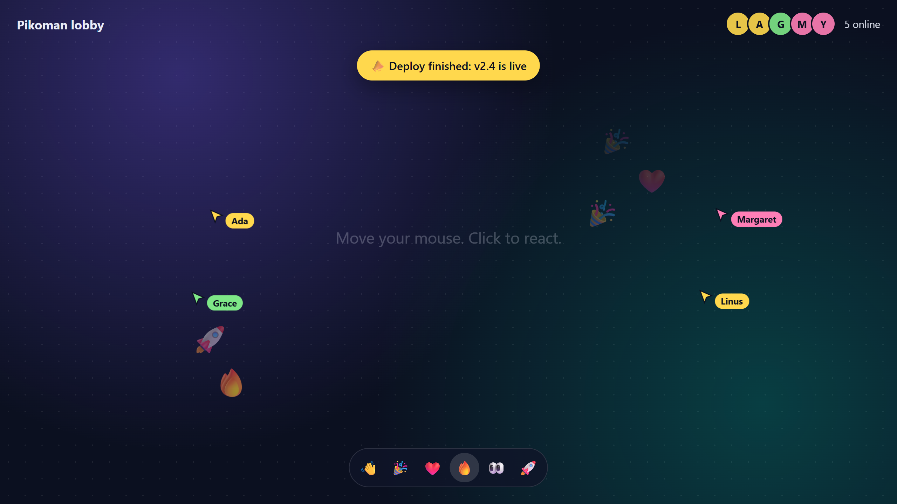

# Pikoman example



Live cursors, reactions and who's online, on [Pikoman](https://pikoman.se) in one small
[Solid](https://solidjs.com) page and a 70-line backend.

- **Live cursors**: everyone's pointer, with their name and colour, as they move.
- **Emoji reactions**: click anywhere and everyone sees it float up.
- **Who's online**: a presence channel, `presence-lobby`, keeps the list. Joining needs a token
  signed by your backend; `server.mjs` is that backend, with no dependencies.
- **A banner from your backend**: one `curl` to the public channel `main-channel` shows up on every
  open page at once.

## Setup

1. Create an app in the [dashboard](https://pikoman.se/dashboard/) and let it generate the keys.
   You get the app id, an API key and a private key; the private key is shown only once.
2. Put the app id in `.env.local`:

   ```bash
   cp .env.example .env.local   # VITE_PIKOMAN_APP=app-yourapp
   npm install
   ```

3. Start the token server with the private key (it never goes in the page), and the page:

   ```bash
   PIKOMAN_PRIVATE_KEY=... npm run server   # http://localhost:3001
   npm run dev                              # http://localhost:3000
   ```

   On Windows PowerShell: `$env:PIKOMAN_PRIVATE_KEY = "..."; npm run server`.

## Publish from your backend

Messages to a channel are sent over HTTP with the app's API key:

```bash
curl -u app-yourapp:$PIKOMAN_API_KEY \
  -H 'content-type: application/json' \
  -d '{"message": "Deploy finished: v2.4 is live"}' \
  https://next-api.pikoman.se/main-channel/announcement
```

Every open page shows the banner at once.

## Join tokens

`server.mjs` signs a JWT with EdDSA (Ed25519) for one connection and one channel:
`connection`, `channel`, `access` (3: a full member), `data` (what the others see about you) and
`exp` (at most 10 minutes ahead). Only channels it allows get a token. More, with PHP and other
languages: [Protocol 2.0](https://pikoman.se/docs/v2/).

While 2.0 runs next to 1.x, the client connects to `wss://next.pikoman.se` and publishing goes to
`https://next-api.pikoman.se`; they move to `ws.` and `api.pikoman.se` with `@pikoman/ws` 1.0.0.

## License

MIT
